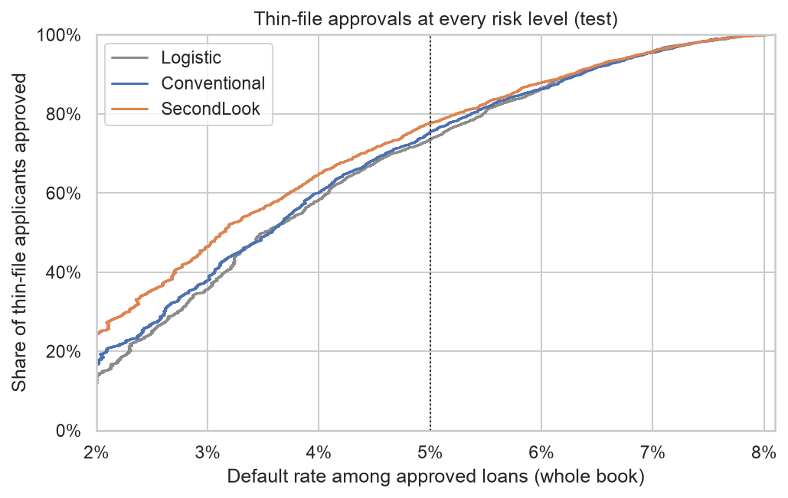
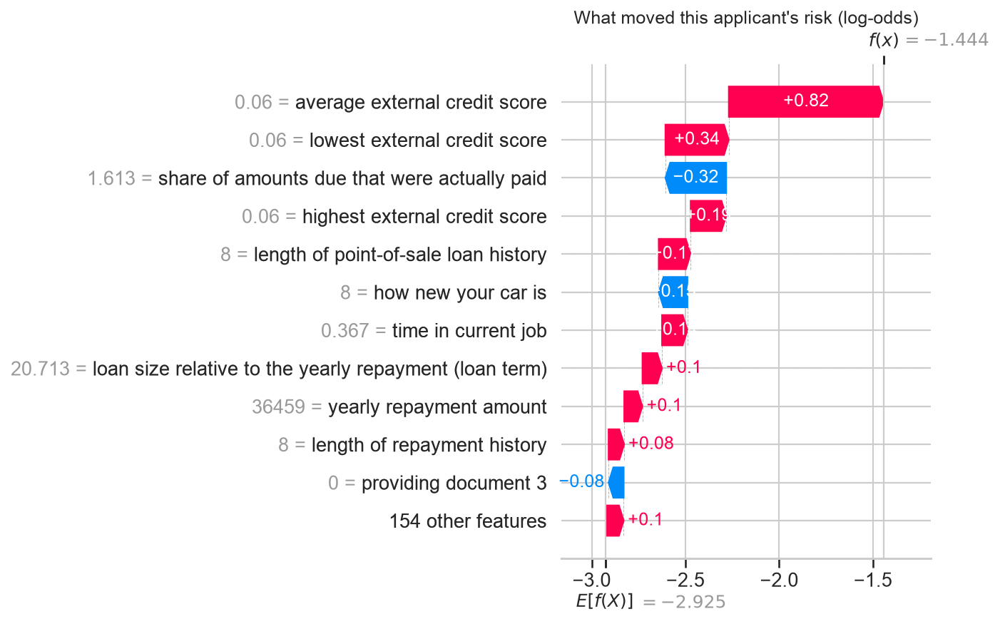
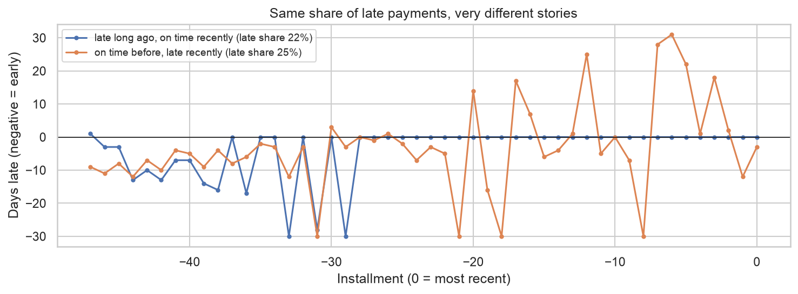
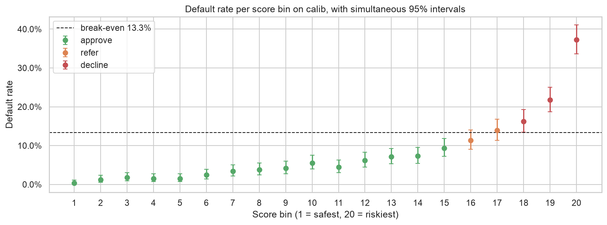
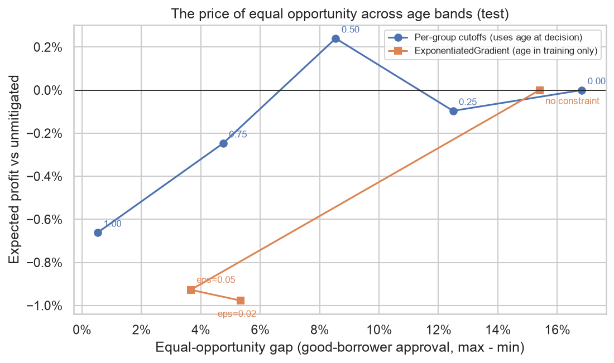

# SecondLook

**Fair, explainable credit scoring for applicants with thin credit files.**
Capstone project, Python for Data and AI. Sector: Banking, Finance, and Insurance.

## Problem

Many people are declined for loans because they have little or no credit history, not because they are risky.
In our data, **1 in 7 applicants (14.3%) has no credit bureau history**, and one of the strongest standard
risk scores (`EXT_SOURCE_3`) is **missing for 97% of them**. A conventional model is least informed exactly
where a lender most needs help.

**Business question:** How many more thin-file applicants can a lender safely approve, at the same default
rate, by using alternative data, and how do we keep those decisions explainable, fair and honest about uncertainty?

## What SecondLook does

1. Scores each applicant's default risk with a calibrated LightGBM model built on alternative data (repayment history, previous applications).
2. Corrects for the bias of training only on approved loans (**reject inference**, validated with a simulation study).
3. Learns repayment behaviour from month-by-month payment histories (**sequence encoder**).
4. Approves, declines or **refers to an underwriter** when the model is unsure (**conformal prediction**).
5. Explains each score with SHAP and suggests a realistic path to approval (borrow less, bigger down payment, pay down debt, lower card use; never age, gender or past defaults).
6. Writes a plain-language decision letter with Claude, then checks it against the model.
7. Audits decisions for fairness across gender and age, and measures the accuracy/fairness trade-off.

Gender and age are kept **only** for the fairness audit and are never model inputs (enforced in `features.model_columns`, covered by tests).
After the notebook 08 audit, three more columns are excluded (`config.EXCLUDED_INPUTS`): family status and number of children
(protected traits in several jurisdictions) and `EMPLOYED_AGE_RATIO`, which let the model reconstruct age exactly. Removing
them cost no measurable accuracy. Other inputs still correlate with age and gender, so decisions are also audited by outcome.

> **Running notebooks:** each notebook, app page and script adds `src/` to Python's path itself, so `import secondlook`
> works even where macOS hides the editable-install file from Python 3.13.

## Data

[Home Credit Default Risk (Kaggle)](https://www.kaggle.com/competitions/home-credit-default-risk/data):
307,511 labelled applicants (8.07% default rate) plus 6 credit-history tables (~58M rows).

The data is not stored in this repo. To download it, accept the competition rules on Kaggle, put your API token
in `~/.kaggle/`, then:

```bash
python scripts/download_data.py
```

This extracts the CSVs into `data/raw/`. If you already have the Kaggle zip, put it in `data/raw/` as
`home-credit-default-risk.zip` instead; `src/secondlook/data.py` reads either layout.

## Project structure

```
data/raw/          Kaggle CSVs or zip (not committed)
data/interim/      temporary extracts (not committed)
data/processed/    features.parquet, splits.parquet (not committed)
notebooks/         01 EDA, 02 features, 03 modelling, 04 explainability, 05 letters,
                   06 reject inference, 07 sequence encoder, 08 conformal + fairness
src/secondlook/      reusable Python package:
                     data.py           load tables (CSV or zip)
                     cleaning.py       fix anomalies, analyst-style ratios
                     sql_features.py   credit-history summaries in SQL (DuckDB)
                     features.py       full pipeline + fixed train/valid/calib/test split
                     modeling.py, explain.py, letters.py
                     reject_inference.py, sequence.py (data) + sequence_model.py (GRU),
                     conformal.py, fairness.py, review.py (what the app page shows)
app/               Streamlit app (streamlit_app.py + app_pages/: overview, applicant review)
models/            trained model bundles + metadata JSON (not committed; rebuild with notebook 03)
reports/figures/   charts used in the README and pitch
docs/              feature dictionary, model card
scripts/           download data, build feature dictionary, train the sequence GRU
tests/             unit tests (pytest)
```

## Setup

```bash
python3 -m venv .venv && source .venv/bin/activate
pip install -r requirements.txt
pip install -e .
cp .env.example .env          # then add your ANTHROPIC_API_KEY
```

Build the model-ready feature table (about 20 seconds; writes `data/processed/features.parquet` and `splits.parquet`):

```bash
python -m secondlook.features
```

Or run `notebooks/02_features.ipynb`, which does the same step by step with explanations.

> **macOS + Python 3.13 note:** if `import secondlook` fails after `pip install -e .`, macOS may have hidden the
> editable-install file. Fix with `chflags nohidden .venv/lib/python3.13/site-packages/__editable__.secondlook-*.pth`.
> The tests do not depend on it (`pyproject.toml` puts `src/` on pytest's path).

Run the tests and the app:

```bash
pytest
streamlit run app/streamlit_app.py
```

## Method notes

- **Fixed split:** 60% train / 15% valid / 10% calib / 15% test, stratified by default status *and* thin-file status. The calibration slice is reserved for probability calibration and conformal prediction.
- **Evaluation:** ROC-AUC and PR-AUC (overall and thin-file), calibration (Brier score), approval rate vs default rate vs expected profit, conformal coverage and referral rate, fairness gaps by group, and the share of letter reasons that match the model's real top reasons.

## Key EDA findings so far

| Finding | Number |
|---|---|
| Applicants / default rate | 307,511 / 8.07% |
| Thin-file share (no bureau history) | 14.3% |
| Default rate, thin-file vs has bureau history | 10.1% vs 7.7% |
| `EXT_SOURCE_3` missing, thin-file vs others | 96.9% vs 6.9% |
| Thin-file applicants with Home Credit repayment history | 94.6% |
| Applicants with a previously refused application | 32.6% |

## Model results (notebook 03, test split)

Conventional = application + credit bureau data only (what a typical lender sees). SecondLook adds alternative data
(previous applications, repayment history, POS and card behaviour). Both are calibrated LightGBM models.

| Model | ROC-AUC | PR-AUC | ROC-AUC (thin-file) | PR-AUC (thin-file) |
|---|---|---|---|---|
| Logistic regression | 0.7580 | 0.2355 | 0.7250 | 0.2360 |
| Conventional LightGBM | 0.7628 | 0.2441 | 0.7324 | 0.2532 |
| **SecondLook LightGBM** | **0.7753** | **0.2579** | **0.7545** | **0.2690** |

**Thin-file approvals at the same risk** (share of thin-file applicants approved when the whole approved book has the given default rate):

| Default rate on approved book | Conventional | SecondLook | Gain |
|---|---|---|---|
| 3% | 37.9% | 46.5% | +8.6 pts |
| 4% | 60.1% | 64.7% | +4.6 pts |
| 5% | 75.3% | 77.7% | +2.4 pts |

At the profit-maximising cutoff (illustrative: +10% margin if repaid, −65% if defaulted), SecondLook earns 1.5% more
on the test applicants than the conventional model, with a lower default rate on approved loans (4.86% vs 5.17%).



## Explanations and path to approval (notebook 04, test split)

- Every decision is explained with exact TreeSHAP values from LightGBM, translated into plain language (`explain.top_reasons`).
- **Borderline declines** (within 5 points of the cutoff) are 28% of all declines: 1,580 test applicants, 20% of them thin-file.
- **Path to approval** (`explain.path_to_approval`) searches the smallest change on levers the applicant controls
  (borrow less, bigger down payment, pay down debt, lower card use), recomputing every derived ratio so the
  suggested applicant is consistent, and requiring a 1-point safety margin below the cutoff.
  A path exists for **83%** of borderline applicants with bureau history and **68%** of thin-file ones (median change 35%).
- A longer loan term is **not** suggested by default: the model's response to term is jagged (it tracks specific loan
  products), so suggesting it would exploit a modelling artefact rather than lower real risk.



## Decision letters (notebook 05)

Claude Haiku 5.5 (`claude-haiku-5-5`) writes a plain-language letter for each declined applicant, built so it cannot drift from the model:

1. Claude sees only the **facts** the model produced, each with an ID (`R1…` reasons, `S1…` strengths, `P1…` steps), never the applicant's data.
2. It returns a **structured letter** (structured outputs) in which every reason and step sentence cites a fact ID; the text is assembled in code, with our own footer offering a human review.
3. **Deterministic checks** (`letters.check_letter`): all main reasons covered in order, no protected attributes, no promise of approval, no technical terms or feature codes, length limit.
4. **Faithfulness judge** (`letters.judge_letter`): a second Claude call sees only the facts and the finished letter and lists anything unsupported. The notebook also plants false statements into good letters to measure whether the judge catches them.
5. One retry with the failures as feedback. If Haiku declines a request, the same request goes to Claude Opus 5.5 (Haiku 5.5 has no
   server-side refusal fallback; Opus keeps its own). If both decline, or a main reason is family status or number of children (no longer model inputs, kept as a safety net), the applicant goes to a human reviewer.

**Results (20 borderline declines):** all 20 letters passed every check on the first attempt; the judge caught
**5 of 5** deliberately planted false statements; about **$0.01–0.02 for all 20 letters** (0.1 cent each; no request needed Opus). Claude Opus 5.5 gave
the same results for $0.41, so the smaller model is the better fit. See [docs/sample_letters.md](docs/sample_letters.md).

Requires `ANTHROPIC_API_KEY` in `.env`. The notebook tracks token usage and stops at a $3 spending cap; cost is priced per model.

## Reject inference (notebook 06)

Real declined applicants never get a loan, so reject inference cannot be validated on them. We use the standard
**simulation**: a conventional lender declines the riskiest 30% of applicants (out-of-fold scores, so the policy cannot
"remember" outcomes), and models trained on the approved 70% are compared with an oracle trained on everyone.

| Model (test split) | AUC, all | AUC, declined by old policy | AUC, thin-file | Thin-file approved @ 4% default |
|---|---|---|---|---|
| Approved-only | 0.7637 | 0.6476 | 0.7398 | 60.8% |
| **Fuzzy augmentation** | **0.7663** | **0.6537** | **0.7431** | **61.8%** |
| Parcelling | 0.7658 | 0.6442 | 0.7385 | 60.6% |
| Oracle (all outcomes) | 0.7756 | 0.6769 | 0.7549 | 64.3% |

Fuzzy augmentation recovers about 22% of the gap, and a bootstrap confirms the gain overall (+0.0026) and on the declined
group (+0.0062); the thin-file gain is suggestive (its 95% interval includes zero). It helps when the old policy declined
20–30% of applicants but is about level at 40%. Parcelling hurts the groups it is meant to help.

## Payment-history sequence encoder (notebook 07)

A GRU (PyTorch) reads each applicant's last 48 installments in time order, so it can tell "late long ago, on time since"
from "started paying late recently", which averages cannot. It is trained **out-of-fold** (5 folds) and its single
sequence risk score is added to LightGBM.

| Test split | AUC, all | AUC, thin-file | AUC, has history | Thin-file approved @ 4% |
|---|---|---|---|---|
| SecondLook (notebook 03) | 0.7756 | 0.7549 | 0.7743 | 64.3% |
| **SecondLook + sequence score** | **0.7782** | **0.7602** | **0.7776** | **66.5%** |

The gain is confirmed by a paired bootstrap overall (+0.0028) and for applicants with history (+0.0035); the GRU score
is the #2 feature by gain. On its own it beats a model on the installment averages (AUC 0.638 vs 0.588).



> PyTorch and LightGBM crash in one process on macOS (clashing OpenMP runtimes), so the GRU trains via
> `scripts/train_sequence_scores.py` and its tests run in a separate process.

## Conformal referral and fairness audit (notebook 08)

**When the model is unsure, refer.** Class-conditional conformal prediction sets keep their guarantee on test
(90.3% of repayers and 89.2% of defaulters covered at a 90% target; standard conformal covers only 0.4% of defaulters).
But they would refer 48% of applicants. SecondLook therefore refers at the **decision** level: each score bin gets a
simultaneous 95% Clopper-Pearson interval for its default rate (fit on `calib`), compared with the 13.3% break-even rate.

| Zone (test split) | Share of all applicants | Default rate | Share of thin-file applicants |
|---|---|---|---|
| Approve (interval below break-even) | 75.0% | 4.1% | 65.6% |
| **Refer to an underwriter** (interval straddles it) | **10.1%** | **13.0%** | **13.8%** |
| Decline (interval above it) | 14.9% | 25.0% | 20.6% |



**Fairness audit** (production cutoff, test split). The model is calibrated within every gender and age group, but real
default rates differ, so equal opportunity is not met.

| | Good borrowers approved | Default rate |
|---|---|---|
| Female / male | 92.0% / 87.1% | 7.1% / 9.9% |
| Age 18–29 / 60–69 | 80.3% / 97.1% | 11.1% / 4.8% |

- **Proxies:** model inputs predict gender with AUC 0.90 and "under 30" with AUC 0.96 (occupation, car ownership,
  career length). The first model version also had `EMPLOYED_AGE_RATIO`, which with `YEARS_EMPLOYED` gives back age
  exactly (AUC 0.999). It is now excluded, along with family status and number of children, at no measurable cost
  (AUC −0.0005, 95% interval −0.0021 to +0.0013).
- **Mitigation for age:**
  - Per-group cutoffs close the gap from 16.8 to 0.5 points for −0.7% profit, but they use age at decision time.
  - Fairlearn `ExponentiatedGradient` cuts it from 15.4 to 3.7 points for −0.9% profit, using age only in training.



**Recommendation:** refer the uncertain zone to underwriters, and track the equal-opportunity gap on every model release.
Whether to close the age gap, and how far, is a policy choice; notebook 08 prices it at about 1% of profit.

## App (Streamlit)

```bash
streamlit run app/streamlit_app.py
```

The **Applicant review** page takes any applicant from the held-out test split and shows:

- **The decision** (approve, refer to an underwriter, or decline), with the default rate and 95% interval of the
  applicant's score band compared with the 13.3% break-even rate (notebook 08).
- **Why:** the ten factors that moved this applicant's risk most (SHAP), and plain-language tables of what raised and lowered it.
- **Path to approval** for referred and declined applicants: the smallest change that reaches automatic approval or,
  failing that, at least review by an underwriter (notebook 04).
- **Decision letter** for declined applicants, written on demand by Claude Haiku 5.5 (Opus 5.5 only if Haiku declines)
  and checked before it is shown (notebook 05). Needs `ANTHROPIC_API_KEY` in `.env`; about 0.1 cent per letter.

Filter by decision and thin-file status, pick an ID or press **Random applicant**. The app needs
`data/processed/features.parquet` and the model bundle from notebook 03.

## Roadmap

- [x] Data download, EDA, SQL history features, fixed splits, tests
- [x] 03 Modelling: baseline vs conventional vs SecondLook LightGBM, calibration, risk-appetite and profit cutoffs
- [x] 04 Explainability: SHAP reasons, thin-file vs bureau explanations, path to approval
- [x] 05 Letters: structured Claude letters, deterministic checks, faithfulness judge, planted-error test
- [x] 06 Reject inference: simulation study, fuzzy augmentation vs parcelling, bootstrap intervals
- [x] 07 Sequence encoder: out-of-fold GRU over installments, stacked into LightGBM
- [x] 08 Conformal referral + fairness audit: conformal sets, break-even referral zones, fairness audit, ExponentiatedGradient vs per-group cutoffs
- [x] Streamlit app: applicant review page (decision, reasons, path to approval, on-demand letter)
- [ ] Written summary, model card and pitch

## Acknowledgements

This repo extends our group's [SecondLook](https://github.com/Funkchini/secondlook) project (same name, same Home Credit data and project layout) with alternative data, reject inference, a sequence model, conformal referral and a fairness audit.
