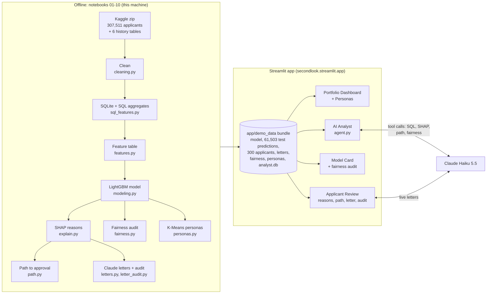

# SecondLook

**An AI-assisted second review for borderline loan declines.**

A Group 3 Capstone Project for Uplift Code Camp, Python for Data and AI (Batch 3).

**Live app:** [secondlook.streamlit.app](https://secondlook.streamlit.app) · **Written summary:** [docs/SecondLook - Summary.pdf](docs/SecondLook%20-%20Summary.pdf)

## Problem

About half of Filipino adults have no formal financial account, and thin credit files get many of them declined with no explanation.

**Business question:** Among applicants a lender would decline, which ones are actually safe to approve, and what realistic changes would get the rest approved?

## What SecondLook does

1. Scores each applicant's default risk with a trained model.
2. Flags borderline declines near the approval cutoff.
3. Explains each score with SHAP.
4. Suggests a realistic path to approval (never age, gender or past defaults).
5. Writes a plain-language decision letter with Claude, then checks it against the model.
6. Answers portfolio questions in plain English through an AI agent.

## Architecture



The heavy work (2.3 GB SQLite database, training, SHAP, the audits) runs offline in the notebooks. Its results are saved into a small bundle (`app/demo_data/`), so the app runs on Streamlit Cloud without the Kaggle data. Claude is called only for live letters and the AI Analyst.

## Results

All figures are on the **61,503 test applicants** (20%) the model never saw during training.

| Area | Result | Where |
|---|---|---|
| Model | LightGBM ROC AUC **0.786** (5-fold CV 0.784 ± 0.002) vs 0.773 for logistic regression; calibrated within about 1 point in every decile | notebook 03 |
| Decision rule | Approve if PD < 0.17 (profit-maximising): **88%** approved, **5.3%** default rate among approved (8.07% overall) | notebook 03 |
| Business value | About **14% more approvals at the same 5% default rate** than ranking by external credit score alone | notebook 03 |
| The opportunity | **71%** of the applicants we don't approve would have repaid; **2,611** are in the under-review band (PD 0.17-0.22) | notebooks 03, 09 |
| Explanations | SHAP values add up to the model's output exactly; under 1% of borderline applicants have a sensitive trait among their top 3 reasons | notebook 04 |
| Path to approval | **90.1%** of under-review and **31.3%** of declined applicants have a re-scored path (borrow less or more payments) | notebook 06 |
| Letters | 30 of 30 demo letters pass the guardrail rules, about $0.0007 each | notebook 05 |
| Letter audit | **91.6%** of claims supported; catches all 4 planted errors; 9 of 16 flags (56%) are real problems, so it is a triage aid for the officer | notebook 07 |
| Fairness | Calibrated in every group and passes the four-fifths check (closest: ages 20-29 at **0.82**). But repayers aged 20-29 are approved **83.1%** of the time vs **97.2%** at 60-69, and every bootstrap interval excludes zero. Retraining without the sensitive features made the age gap *worse*, so we ship the full model with human review | notebook 08 |
| Personas | Five K-Means personas among the 7,263 not approved; "Newer job, clean record" is the largest (41%). Repayment is 70-73% in every persona | notebook 09 |
| AI Analyst | **20 of 20** test answers correct over two runs (checked against pandas), 18 of 18 off-topic probes handled, about **$0.0008** per question | notebook 10 |

## Data

[Home Credit Default Risk (Kaggle)](https://www.kaggle.com/competitions/home-credit-default-risk/data): 307,511 labelled applicants (8.07% default rate) plus 6 credit-history tables.

The data is not stored in this repo. To download it:

```bash
pip install kaggle
kaggle auth login            # or put your token in ~/.kaggle/
kaggle competitions download home-credit-default-risk -p data/raw
```

Keep the zip as is. The code reads CSVs straight from it (`src/secondlook/data.py`).

## Project structure

```
data/raw/          Kaggle zip (not committed)
data/interim/      cleaned tables, SQLite DB (not committed)
data/processed/    model-ready features (not committed)
notebooks/         01 EDA, 02 features, 03 modelling, 04 explainability, 05 letters,
                   06 path to approval, 07 letter audit, 08 fairness audit, 09 personas,
                   10 AI Analyst
src/secondlook/    reusable Python package: data.py (load from zip), cleaning.py,
                   sql_features.py (SQLite + SQL aggregations), features.py (pipeline),
                   modeling.py, explain.py (SHAP), path.py (path to approval),
                   letters.py (Claude), letter_audit.py (faithfulness + tone),
                   fairness.py (group metrics, bootstrap, retrain experiment),
                   personas.py (K-Means personas), agent.py (AI Analyst tools + loop),
                   analyst_db.py (builds analyst.db), analyst_eval.py (10 test questions),
                   demo_bundle.py
app/               Streamlit app (Home.py + pages/), demo_data/ bundle, requirements.txt
tests/             pytest tests (letter guardrails, letter audit, fairness, personas, AI Analyst, formatting, path to approval, app smoke tests)
models/            trained model files (not committed)
reports/figures/   charts used in the README and pitch
docs/              written summary, feature dictionary
```

## Setup

```bash
pip install -r requirements.txt
cp .env.example .env          # then add your ANTHROPIC_API_KEY
```

Build the model-ready feature table (about 10 minutes the first time; creates a 2.3 GB SQLite database in `data/interim/` and `data/processed/features.parquet`):

```bash
cd src && python -m secondlook.features
```

Or run `notebooks/02_features.ipynb`, which does the same step by step with explanations.

## Run the app

The app runs on a small committed bundle in `app/demo_data/` (model, 61,503 test predictions, 300 applicants, pre-drafted letters, personas, fairness results and the read-only `analyst.db`), so **it works straight after cloning**, without the Kaggle data:

```bash
pip install -r app/requirements.txt
streamlit run app/Home.py
```

| Page | What it shows |
|---|---|
| **Home** | Problem, headline results, how SecondLook works |
| **Portfolio Dashboard** | Overview tab: risk distribution, live cutoff and profit simulator, calibration, approvals vs score-only, thin-file results. Personas tab: five K-Means borrower personas among the not-approved, with a PCA map, profiles and how each can be helped |
| **Applicant Review** | One applicant: PD, decision, SHAP reasons, re-scored path to approval (borrow less or a longer term), Claude letter that offers those terms (pre-drafted, or drafted live with an API key), independent audit of the letter (claims vs the model's reasons, tone), officer decision |
| **Model Card** | Model details, metrics, SHAP importance, fairness audit (gender, age, thin file, with bootstrap intervals, the retrain-without-sensitive-features experiment and the decision), intended use and limitations |
| **AI Analyst** | Ask portfolio questions in plain English. Claude Haiku 5.5 writes SQL on a read-only database and calls SecondLook's own tools (SHAP reasons, path to approval, fairness audit); every answer shows its queries, tool calls and cost. Off-topic messages get a fixed reply (2 allowed with a warning, the third closes the chat); 10 questions per session |

Live letter drafting and the AI Analyst need `ANTHROPIC_API_KEY` in `.env` (locally) or in the app's secrets (cloud). Without a key, everything else works and pre-drafted letters are shown.

To rebuild the AI Analyst's database from the bundle: `cd src && python -m secondlook.analyst_db`

To rebuild the bundle after retraining (needs the full pipeline): `cd src && python -m secondlook.demo_bundle`

### Deploy to Streamlit Community Cloud

1. Sign in at [share.streamlit.io](https://share.streamlit.io) with GitHub.
2. **Create app** → repository `Funkchini/secondlook`, branch `main`, main file `app/Home.py`.
3. **Advanced settings** → Python 3.12, and under **Secrets** add `ANTHROPIC_API_KEY = "..."` (optional, for live letters).
4. Deploy. The app installs `app/requirements.txt`.

## Tests

```bash
pytest tests/
```

102 tests: letter guardrail rules (19), letter audit (10, replaying saved Claude answers for one real and four deliberately broken letters), AI Analyst (24: SQL safety, the agent loop with a scripted client, off-topic handling, follow-up sources, and the ten test questions, scope probes and a follow-up conversation graded from recorded runs), value formatting (17), path to approval (6), fairness metrics (5), personas (5) and app smoke tests that run every page, the cutoff slider, the cached letters and their audits, the fairness audit, the Personas tab and the AI Analyst's question and off-topic limits (16). No API calls.

## Limitations

- **Decision support, not automation.** A loan officer makes every final decision and reviews every letter.
- **Unknown country of origin.** The Kaggle data is anonymised and its country is not disclosed. The model would need to be validated on Philippine applicants before real use.
- **Outcomes are only known for past approved loans,** so the model has never seen how applicants the lender declined would have behaved.
- **Fairness gaps remain.** Good young, male and thin-file borrowers are approved less often. Intersections (for example young men with thin files) were not audited.
- **SHAP explains the model, not the world.** A reason is what drove the score, not a proven cause.
- **The letter audit is a triage tool:** about half its flags are false alarms and its verdicts vary between runs. Letters are respectful but low on empathy.
- **The AI Analyst was tested on ten questions we wrote,** about data we know. Vaguer questions will be less reliable, which is why every answer shows its queries.
- **Profit figures use illustrative assumptions** (+15% of the loan on repayment, −60% on default), adjustable on the dashboard.

## Roadmap

- **Phase 1 (done):** EDA, features, models, SHAP, Claude letters, Streamlit MVP, deployed at [secondlook.streamlit.app](https://secondlook.streamlit.app).
- **Phase 2 (done):** path to approval, faithfulness and tone audit, fairness audit, personas, AI Analyst agent, written summary.
- **Next, if continued:** validate on local applicants, audit intersections of groups, raise letter empathy, and monitor calibration over time.

## Team

Group 3. Roles to be filled in.
